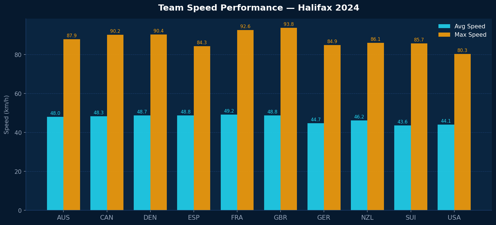
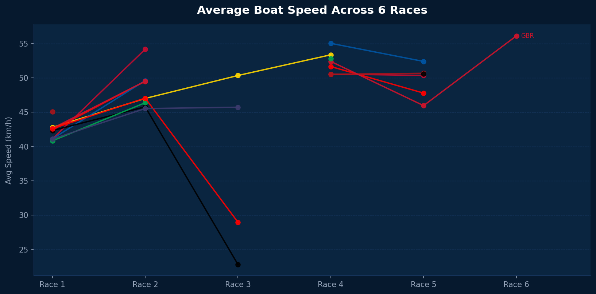
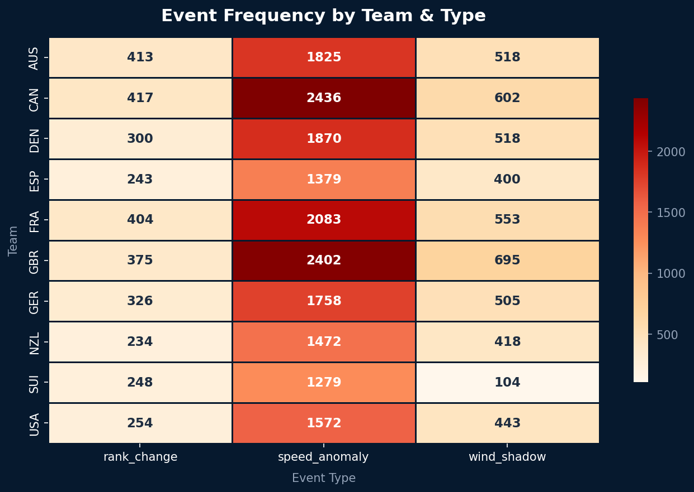
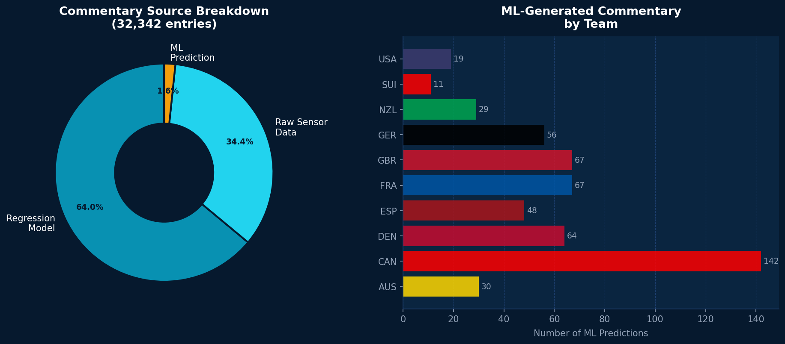

# ⛵ RaceLens AR — See the Race. Feel the Speed.


<p align="center">
  
</p>

An AR spectator companion for SailGP, built for the **Ocean of Data Challenge: Foil Forward** (DeepSense × SailGP, June 2026).

Spectators standing on the dock get the atmosphere but no information: they can't tell which boat just overtook which, or why. Viewers at home get rankings and expert commentary but aren't there. **RaceLens AR closes that gap.** Point your phone at the racecourse and every boat gets a live label with its team, speed and ranking. When something happens on the water, the app explains it in plain English:

> *"Canada is entering Great Britain's wind shadow. Speed dropped 18% in 12 seconds. A tactical push is expected."*

The demo replays real **Halifax 2024** telemetry (6 races, 10 teams, 1 Hz). In a live deployment the logic is identical; only the data source switches from CSV to a real-time stream.

## ✨ Features

- **Live AR boat labels**: GPS-positioned tags with team flag, speed and ranking on top of the camera view
- **AI commentary**: telemetry turned into one-sentence explanations, with live Gemini generation and a local fallback
- **Event timeline**: per-boat history of overtakes, speed anomalies and wind-shadow events
- **Race replay**: scrub through any of the six Halifax races at 1×, 2× or 4× speed
- **Camera mode**: capture photos with the AR overlay on or off

## 🧠 How it works

```
SailGP telemetry (1 Hz CSV)
        │
        ▼
event_detection.py ──► event_log.csv          ranking changes · speed anomalies · wind shadow
        │
        ▼
train_ml.py ─────────► classification_model    Random Forest labels every second:
        │                                        normal · chasing · being chased ·
        │                                        wind shadow · overtaking opportunity
        ▼
generate_commentary.py ► commentary_log.csv    templates filled with live values
        │
        ▼
React app (AR view · timeline · replay)
```

| Event | Trigger |
|---|---|
| Ranking change | Distance-to-leader shifts > 50 m within 15 s (high severity > 150 m) |
| Speed anomaly | Boat speed changes > 15% within 15 s, cross-checked against buoy wind data |
| Wind shadow | True wind speed drops > 10% while wind angle shifts > 5° at the same time |

Classifier features: boat speed, VMG, true wind speed and angle, heel, distance to leader, leg number and leeway.

## 📁 Repository layout

```
app/       React + Vite + Express web app
ml/        Python pipeline: event detection → classifier → commentary
  data/    Processed data and pipeline outputs
data/      Raw SailGP Data Challenge export (Halifax 2024, Bermuda)
design/    Static HTML screen prototypes
docs/      Slides, presentation script, team workflow, charts
```

## 🚀 Quick start

**Web app**

```bash
cd app
npm install
cp .env.example .env.local   # optional: add GEMINI_API_KEY for live AI commentary
npm run dev                  # → http://localhost:3000
```

**ML pipeline**

```bash
cd ml
uv sync                      # or: pip install pandas scikit-learn joblib
uv run event_detection.py
uv run train_ml.py
uv run generate_commentary.py
```

**Design prototypes**: open any file in `design/prototypes/` directly in a browser.

## 📊 Analysis

| Team speed | Speed per race |
|---|---|
|  |  |
| **Event heatmap** | **Commentary analysis** |
|  |  |

## 🗂 Data

### Raw data: `data/sailgp/`

SailGP telemetry provided for the Ocean of Data Challenge. Each venue folder (`Halifax/`, `Bermuda/`) contains:

| Path | Contents |
|---|---|
| `boats/Race_N/<TEAM>.csv` | Per-boat telemetry at 1 Hz (speed, VMG, wind, foil and wing angles, distance to leader, …) |
| `marks/Race_N/marks.csv` | Course mark positions |
| `xmls/Race_N/*.xml` | Race course and start configuration snapshots |
| `race_metadata.csv` | Race list, times and conditions |
| `data_dictionary.md` | Full description of every field |

### Processed data: `ml/data/`

| File | Description |
|---|---|
| `merged_halifax.csv` | All Halifax 2024 boats and races merged into one per-second table (pipeline input) |
| `regression_output.csv` | Regression model output from the data-cleaning workstream |
| `buoy_tide_reference.csv` | Smart Atlantic Buoy wind and tide readings, Halifax, 1–2 June 2024 ([smartatlantic.ca](https://www.smartatlantic.ca/)) |
| `event_log.csv` | Output of `event_detection.py` |
| `commentary_log.csv` | Output of `generate_commentary.py`: per-second plain-language commentary |

The trained model (`ml/models/classification_model.pkl`, ~90 MB) is not committed. Run `train_ml.py` to recreate it.

## 👥 Team

Neo and Senxu · Ocean of Data Challenge: Foil Forward, DeepSense Halifax
